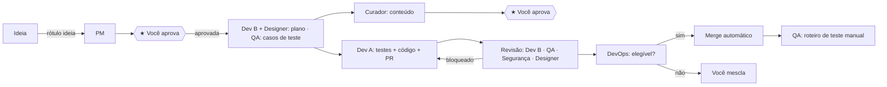

# Processo AI-SDLC do Semear

Decisão e motivos: [ADR 0029](adr/0029-processo-ai-sdlc.md). Agentes em `.claude/agents/`.

## Seus portões (★)
| Portão | Quando | Como você aprova |
|---|---|---|
| ★ 1. Estória | O PM deixa a estória em `aguardando-aprovacao` | Leia e coloque o rótulo `aprovada` (ou comente o que mudar) |
| ★ 2. Conteúdo | PR com rótulo `conteudo` (marcos, atividades, livros, orientação aos pais) | Leia o resumo do Curador e mescle o PR |

Tudo o mais os agentes tocam sozinhos.

## Fluxo

## Papéis
| Agente | Faz | Edita |
|---|---|---|
| `pm` | estórias, critérios, ROADMAP | issues, ROADMAP, spec |
| `designer` | desenho e revisão visual | DESIGN.md, prototipos/, CSS |
| `dev-senior-a` | implementa | `app/` |
| `dev-senior-b` | plano técnico, ADR, revisão | `app/`, ADRs |
| `qa` | casos de teste, validação, roteiro manual | `app/tests`, `app/e2e` |
| `curador-pedagogico` | conteúdo e orientação aos pais | `app/content/` |
| `seguranca-privacidade` | revisão com veto | nada (só comenta) |
| `devops-release` | CI, release, rollback, merge elegível | `.github/`, ADRs |

## Como usar
- **No Claude Code:** `/ciclo #42` (estória existente) ou `/ciclo "ideia em texto"`.
- **No GitHub:** abra uma issue com o rótulo `ideia`; depois de ler a estória, coloque `aprovada`.
  Rótulos usados: `ideia`, `aguardando-aprovacao`, `aprovada`, `conteudo`, `ui`, `dados`, `decisao`, `bloqueado`.

## Merge automático: quando acontece
CI verde + revisores sem `bloqueado` + PR sem `conteudo`/`decisao` e sem tocar `app/content/`, `app/src/dados/`,
CSP, `.github/`, `CLAUDE.md` ou `docs/adr/`. Fora disso, só você mescla.

## Configuração única (ações suas no GitHub)
1. Segredo `CLAUDE_CODE_OAUTH_TOKEN` (ou `ANTHROPIC_API_KEY`) em Settings → Secrets → Actions.
2. Settings → General → habilitar **Allow auto-merge**.
3. Ruleset "Proteger main": manter as verificações obrigatórias; retirar a exigência de aprovação humana para PRs elegíveis
   (ou usar CODEOWNERS nos caminhos sensíveis).
4. Criar os rótulos acima.
5. Os workflows só passam a valer depois de mesclados no `main`.
