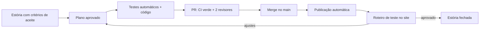

# Roteiro de desenvolvimento do Semear

Este documento organiza as estórias do GitHub em **fases**. Cada fase termina com algo que funciona
e que dá para **demonstrar e testar no site publicado** (https://priwol.github.io/Semear/), no
celular e no computador. A fase só fecha quando a dona do produto roda o **roteiro de teste** dela e
aprova.

Cada fase também é uma **versão** do app (Fase 0 = v0.2, Fase 1 = v0.3…). A versão aparece no próprio
app (estória "Versão publicada e novidades"), então dá para saber exatamente o que está no ar.

## Como uma estória vira algo testável

- **Testes automáticos** (rodam em todo PR): unitários nas regras, integração no banco do aparelho e
  ponta a ponta (e2e) simulando o uso no computador e no celular.
- **Sem prévia por PR, por enquanto** (proposta de 14/10/2026, a ser decidida na #40 e registrada em ADR): cada mudança é testada no site publicado, logo depois do merge, então um bug chega ao site antes do teste manual. O rollback é reverter o merge no `main`, mas **dados já gravados no IndexedDB por uma versão ruim não voltam com o revert**; por isso toda mudança de formato de dados precisa de migração testada. Além disso, o IndexedDB recusa abrir um banco de versão mais nova com o app antigo (`VersionError`), então, antes de testar uma fase com migração, faça o **backup** pela tela do app, e o ADR da #40 deve exigir migrações que o app anterior consiga ler e descrever como o service worker do PWA é atualizado depois de um revert.
- **Seus testes** (manuais, no site publicado): cada fase tem um roteiro curto, abaixo. A **família de
  exemplo** (Fase 0) deixa você testar tudo em 1 minuto, sem digitar dados.
- As fases 0 a 3 listam os testes automáticos novos que entram com elas. Nas fases 4 a 6, eles estão nos critérios de
  aceite de cada estória e serão detalhados quando a fase chegar.

## Visão geral

| Fase | Versão | O que você consegue demonstrar no fim | Estórias |
|---|---|---|---|
| 0 · Base para testar | v0.2 | Abrir o site, ver a versão, carregar uma família de exemplo e imprimir uma sessão numa folha só | #38 #39 #33 #36 #31 |
| 1 · Visual novo | v0.3 | Todas as telas e as folhas no visual "moderno e clássico", com navegação de app no celular | #14 #41 #42 #2 (parte 1) #15 |
| 2 · Ciclo da sessão | v0.4 | Preparar → imprimir → aplicar → **registrar no celular** → jornada atualiza sozinha; buscar e imprimir uma atividade avulsa | #11 #13 · conteúdo: #21 #22 |
| 3 · Rotina da semana | v0.5 | Planejar a semana (ex.: seg/qua/sex), imprimir tudo num arquivo só e acompanhar os dias feitos | #8 #9 #2 (parte 2) |
| 4 · Pronto para o piloto | v0.6 | Endereço próprio, sondagem impressa para posicionar, guia das vertentes e estante de livros; 3 a 5 famílias usando | #34 #32 #17 #30 #12 → #28 |
| 5 · Evidências e portfólio | v0.7 | Fotos dos trabalhos, ressondagem, sessão de irmãos e o **portfólio trimestral em PDF** | #10 #18 #19 #29 #20 |
| 6 · Abrir ao público | v1.0 | Landing page, conta, teste gratuito (14 ou 30 dias, §9.3), pagamento por família e sincronização | #25 #26 #3 #6 #5 #4 #27 |
| Trilha de conteúdo | contínua | Mais marcos, atividades, livros e ilustrações a cada lote | #21 #22 #23 #24 |

**Por que esta ordem:**
- A Fase 0 vem primeiro porque tudo depois depende de você conseguir testar rápido o que foi publicado.
- O visual (Fase 1) vem antes das telas novas: assim cada tela nova já nasce no estilo final, sem retrabalho.
- O ciclo da sessão (Fase 2) fecha o "loop" do produto: sem registrar o progresso, a jornada não anda sozinha.
- O **domínio próprio vem antes do piloto** (Fase 4): os dados ficam presos ao endereço onde foram criados.
  Se as famílias do piloto começarem em `priwol.github.io` e depois mudarmos, elas teriam que exportar e importar.
- Conta e pagamento (Fase 6) só depois do piloto de 8 semanas (#28) confirmar que o núcleo do produto funciona.
  (O teste rápido com o PDF do protótipo, §12.2 da especificação, pode acontecer antes, a qualquer momento.)

---

## Fase 0 · Base para testar (v0.2)

**Objetivo:** deixar o site publicado fácil de testar e transparente sobre o que está no ar.

| Estória | O que entrega |
|---|---|
| #38 Versão publicada e novidades | Versão + data no topo e em Configurações; página "Novidades" com o que mudou em cada versão |
| #39 Família de exemplo | Botão "Explorar com uma família de exemplo": cria 2 crianças posicionadas e sessões no histórico; "Apagar exemplo" remove só o que é do exemplo (famílias reais ficam intactas) |
| #33 Ficha em 1 página | A ficha de registro cabe numa folha A4 com até 2 atividades |
| #36 Actions por SHA | Segurança da publicação (sem efeito visível) |
| #31 Arquivar site antigo | Repositório limpo (sem efeito visível) |

**Roteiro de teste (celular e computador):**
1. Abra o site numa janela anônima. A versão `v0.2` aparece no topo.
2. Toque em "Explorar com uma família de exemplo". Em segundos, aparecem Ana (5 anos) e Theo (7 anos), já posicionados.
3. Prepare uma sessão de 40 min para a Ana com 2 atividades, imprima e salve em PDF: a ficha ocupa **uma** página.
4. Abra "Novidades" e confira o que mudou na v0.2.
5. Em Configurações, toque em "Apagar exemplo": o exemplo some e o app volta ao estado anterior; num navegador sem outros dados, mostra a tela de boas-vindas.

**Testes automáticos novos:** unitário da família de exemplo (idades a partir de hoje, posições válidas) e da versão; integração "exemplo + família real: só o exemplo some";
integração de carregar/apagar o exemplo; e2e boas-vindas → exemplo → sessão → apagar; e2e que conta as páginas da ficha no PDF.

---

## Fase 1 · Visual novo, moderno e clássico (v0.3)

**Objetivo:** trocar a identidade visual do app e das folhas, sem mudar os fluxos.
**Direção a escolher na #14**, entre as duas candidatas do protótipo: **A · Caderno de botânica** (marfim, verde-musgo e ocre; Fraunces + Inter) e **B · Biblioteca clássica** (creme, azul-tinta e dourado; Libre Caslon + Source Sans). A escolha vira um ADR.
Protótipo: `prototipos/design/direcoes-visuais.html`.

| Estória | O que entrega |
|---|---|
| #14 Look and feel | Escolha da direção (registrada em ADR), `docs/DESIGN.md` com as regras e os tokens (cores, fontes, espaços) |
| #41 Aplicar o visual ao app | Todas as telas no estilo novo; navegação inferior no celular; ícones de linha no lugar dos emojis da interface |
| #42 Aplicar o visual às folhas | Roteiro, folhas e ficha no estilo novo, em preto e branco, economizando tinta |
| #2 Página principal (parte 1) | Cartão da criança com a próxima sessão sugerida e o progresso por domínio |
| #15 Jornada do usuário | Documento do caminho do educador; vira o roteiro dos testes e2e |

**Roteiro de teste:**
1. Com a família de exemplo, passe por todas as telas no celular: início, jornada, preparar sessão, sessão, família e configurações.
2. A navegação inferior (Início, Jornada, Sessões, Família; Configurações fica dentro de Família, e a Estante entra só na Fase 4) leva às seções principais com um toque; nada fica cortado nem precisa de rolagem para o lado.
3. Imprima uma sessão em preto e branco: títulos legíveis, ilustrações em traço e nenhum fundo colorido grande.
4. Compare com o protótipo da direção escolhida.

**Testes automáticos:** os e2e existentes continuam verdes (os fluxos não mudam) e uma verificação de contraste (AA) roda nas telas principais.

---

## Fase 2 · Ciclo completo da sessão (v0.4)

**Objetivo:** depois de aplicar a sessão, o educador registra o que observou, e a jornada se atualiza sozinha.

| Estória | O que entrega |
|---|---|
| #11 Informar progresso | "Registrar sessão" pelo código impresso, em cerca de 2 minutos no celular; selo "parece pronto" (ícone de broto + texto, conforme o `DESIGN.md`) |
| #13 Atividades avulsas | Buscar ("rimas", "contar") e imprimir uma atividade só |
| #21 + #22 (conteúdo) | Pipeline de conteúdo e as linhas LG.FON e MA.SEN completas, com BNCC |

**Roteiro de teste:**
1. Família de exemplo → prepare e imprima uma sessão para a Ana.
2. Em "Registrar sessão", digite o código impresso (ex.: `S-1014-A1`) e marque os marcos. A jornada da Ana muda.
3. Na ficha da primeira sessão, marque um marco como *Consolidado* (o marco continua *Em desenvolvimento* no mapa). Prepare e registre uma
   segunda sessão com esse mesmo marco, também como *Consolidado*: aparece o selo "parece pronto". Confirme o marco no mapa: o selo some.
4. Busque "sílaba" (sem acento) e imprima a atividade encontrada.

**Testes automáticos novos:** unitário do registro e do selo "parece pronto" e da busca sem acento; integração do
registro (com migração do banco e backup); importação de backup recusando estados fora de *Não observado / Em desenvolvimento / Consolidado* e contando uma só vez a mesma sessão duplicada; e2e "gerar → registrar" e "buscar → imprimir".

---

## Fase 3 · Rotina da semana (v0.5)

| Estória | O que entrega |
|---|---|
| #8 Plano semanal | Escolher dias e duração; o app distribui as atividades pela semana; calendário por criança |
| #9 Imprimir a semana | Um arquivo com todas as sessões, separadores por dia e a lista de materiais consolidada |
| #2 Página principal (parte 2) | Sessões feitas na semana e a próxima ação sugerida |

**Roteiro de teste:** planeje seg/qua/sex de 40 min para a Ana, imprima a semana (um PDF só, com a lista de materiais no começo), registre a sessão de segunda e veja o dia marcado como feito no início.

**Testes automáticos novos:** unitário do distribuidor semanal e da lista de materiais consolidada; integração do
plano no banco e no backup; e2e "planejar → imprimir a semana".

---

## Fase 4 · Pronto para o piloto (v0.6)

| Estória | O que entrega |
|---|---|
| #34 Domínio próprio | App em endereço próprio (ex.: `app.semear.com.br`), isolando os dados das famílias |
| #32 CSP no app | Segunda camada de proteção contra injeção de código |
| #17 Sondagem inicial | Avaliação impressa que posiciona a criança em cada linha |
| #30 Guia das vertentes | Página que explica as 5 vertentes, com link no cadastro |
| #12 Estante de livros | Livros digitais gratuitos, clássicos e com belas ilustrações, filtráveis |
| #28 Piloto | 3 a 5 famílias por 8 semanas; o relatório define a Fase 5 |

**Antes de começar:** o domínio próprio (#34) é uma decisão estrutural (muda a origem onde os dados ficam) e precisa de ADR aprovado.

**Roteiro de teste:** crie uma família nova no endereço próprio, aplique a sondagem impressa, lance os resultados e confira a posição; abra o guia pelo cadastro e um livro da estante.

---

## Fase 5 · Evidências e portfólio (v0.7)

#10 fotos dos trabalhos (só no aparelho, no backup) · #18 ressondagem a cada 8 semanas · #19 sessão de irmãos ·
#29 validação jurídica → #20 portfólio trimestral em PDF com anexo BNCC.

**Antes de começar:** a validação jurídica (#29) vem **antes** do código do portfólio (#20), porque pode mudar o que o
relatório precisa conter. As fotos (#10) ficam só no aparelho e entram no backup: a importação valida cada arquivo
(tipo, tamanho e vínculo com sessões existentes), como manda o `CLAUDE.md` para todo dado vindo de fora, e o ADR 0002
é atualizado.

**Roteiro de teste:** fotografe 2 trabalhos, gere o portfólio do trimestre, confira frequência, marcos, fotos e o anexo BNCC no PDF; exporte e importe o backup com as fotos.

---

## Fase 6 · Abrir ao público (v1.0)

#25 termos e LGPD (bloqueia o resto) · #26 backend de contas · #3 login · #6 logout · #5 pagamento por família ·
#4 landing page · #27 sincronização entre aparelhos.

**Antes de começar (privacidade é inegociável, `CLAUDE.md`):** hoje nenhum dado sai do aparelho. Esta fase cria o primeiro
servidor, então nada de #26, #3 ou #27 começa sem um **ADR aprovado** que diga o que vai para o servidor (só conta
e assinatura; o servidor não sabe quantas crianças existem, §9.4 "Arquitetura que isso exige"), como os dados da sincronização são criptografados de ponta a ponta, por
quanto tempo ficam guardados e onde. O `CLAUDE.md` (seção Privacidade) e o ADR 0002 são atualizados no mesmo PR.

**Roteiro de teste:** do anúncio à assinatura: landing → uso no plano Livre, sem conta → cadastro por e-mail → teste gratuito → fim do teste volta ao Livre → assinatura em ambiente de teste do gateway → cancelamento → exportação dos dados.

---

## Trilha de conteúdo (contínua, a partir da Fase 2)

#21 pipeline de produção (IA rascunha, pessoa revisa) → #22 Linguagem e Matemática com BNCC → #23 Línguas
(inglês, francês, latim) → #24 banco de ilustrações (substitui os emojis das folhas; segue o visual da Fase 1).
Cada lote de conteúdo é um PR próprio e entra no ar sem esperar as fases de software.
